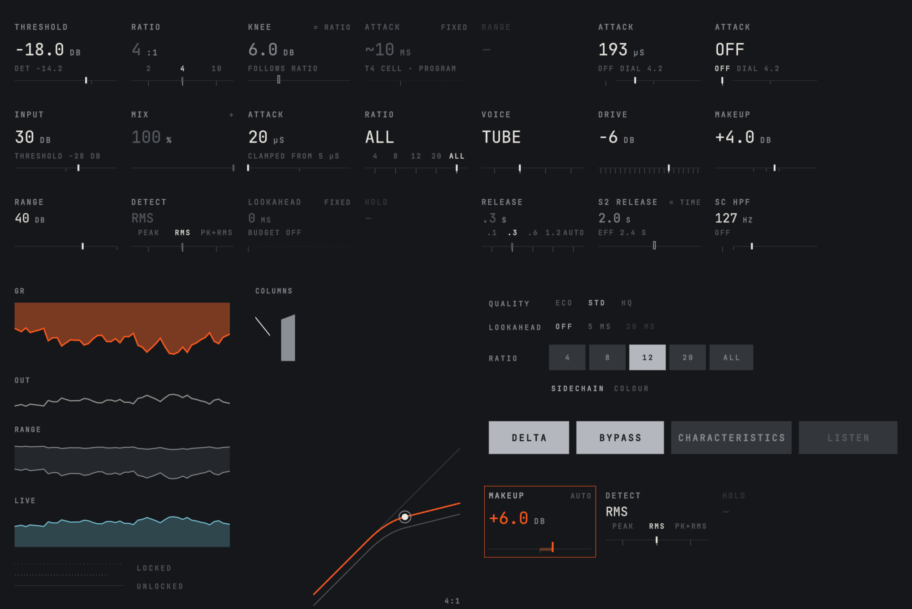

# FunkGui


[](LICENSE)

A GPU user-interface library for JUCE audio plugins on macOS, Linux and Windows. A plugin's interface is a `Panel`
that draws into a `Canvas`. The canvas records primitives on the CPU (rounded rectangles, lines, filled areas,
signed-distance-field text), and bgfx draws the recorded frame in one draw call, on Metal on macOS, on Vulkan on Linux
and on Direct3D 11 on Windows. The same Panel also runs headless, in a console process with a fixed clock and synthetic input, so a test can
check its layout, text and accessibility against golden files and render any frame to a PNG without a GPU. FunkGui also
has a small widget set, a preset store and the test harness itself.

From v0.12.0 the core also builds without JUCE, so the same Panel runs in a browser: compiled to WebAssembly by
Emscripten, on a `<canvas>`, where a WebGL2 sink draws the recorded frame in one draw call. From v0.28.0 it runs in a
desktop window without JUCE too: `FunkGui::desktop`, over SDL3 and the same bgfx frame
([Desktop](#desktop-without-juce)).

FunkGui is the GUI of [FCompressor](https://github.com/Snipet/FCompressor). HardwareReverb, a private plugin whose GUI
code FunkGui grew from, has moved onto it too. FunkGui is at 0.x, and its API may change between minor versions.
Every release is an annotated tag on `main` (latest: `v0.28.0`), and [`CHANGELOG.md`](CHANGELOG.md) says what each
release does to a consumer's golden files.



*Sections of the widget gallery, rendered headless by `FunkGuiGalleryProbe` and `funkgui_framerender` (no GPU, no
window), cropped and tiled.*

## How it works

```
Panel         your UI: one fixed logical size, tick(dt), draw(Canvas&, Theme&), input, accessibility items
  |
Canvas        records primitives on the CPU into a PrimList; makes no GPU calls
  |
  +-- EditorHost + BgfxSink   live: a juce::AudioProcessorEditor; bgfx on Metal, Vulkan or Direct3D 11, one draw call
                              per frame (plus one per custom-shader rectangle or picture and one for the run after
                              it), every primitive one 80-byte instance of a shared quad (v0.26.0)
  +-- WebHost + WebGlSink     browser: a <canvas>, no JUCE; WebGL2, one draw call per frame (plus one per picture)
  +-- DesktopHost + BgfxSink  desktop (v0.28.0): a window of SDL3's, no JUCE; the same bgfx frame as EditorHost's
  +-- HeadlessHost            tests: fixed dt, synthetic input -> frame dump, fingerprint, PNG, accessibility list
  +-- renderGpuPicture        pictures (v0.23.0): any recorded frame drawn offscreen by bgfx and read back as RGBA
```

- A Panel reads no wall clock: time comes from `tick(dt)`. Every ease snaps onto its target, so with a fixed dt a
  headless run settles in an exact number of frames and draws the same frame every time.
- A fingerprint hashes a frame's geometry and text, leaving out colours and live data, so a test can pin a layout in a
  few golden rows. A GPU test captures a real Metal frame of the gallery app and checks that its hashes equal the
  headless frame's. In a browser, a test page reads back what WebGL2 drew and compares it with `SoftRaster`'s image of
  the same frame.
- The host scales the Panel uniformly for the display's backing scale and for optional zoom steps; the Panel always
  draws and takes input in its own logical pixels. A resizable Panel (v0.18.0) lays itself out in any logical size
  from its minimum: the window follows the user's drag, and the Panel is told its new size between frames.

## Features by layer

Public headers live in `include/funkgui/<layer>/`, in namespace `funkgui` (`funkgui::presets` for the presets,
`funkgui::test` for the harness).

- **core**: geometry, colours, two themes (graphite and paper), the type scale, deterministic eases with one
  process-wide animation speed, locale-free number formatting, environment variables read under a product prefix,
  and `FUNKGUI_HAS_JUCE` (`core/HasJuce.h`): 1 when JUCE is under the build, 0 without.
- **canvas**: the recorder. Rounded rectangles (per-corner radii, borders, soft edges), hairlines snapped to device
  pixels, segments, polylines, filled areas and strips, discs, dotted rules and text. Each primitive carries a semantic
  tag and a live flag for tests. Nested clipping, a text dump format, fingerprints, `sameDrawing()` (0.25.0: whether two
  recorded frames draw the same picture), and `SoftRaster`, a CPU rasteriser that mirrors the fragment shader.
  `shader()` (v0.19.0) records a rectangle that a host's own fragment shader fills, in order with the primitives and
  under the clip in force; `SoftRaster` draws it as a striped placeholder.
  `image(id, dst, radius, opacity, uv)` (v0.20.0) draws a picture from `Images.h`, a process-wide registry of decoded
  RGBA8 pictures by id (`images::set`, `remove`, `has`; any thread may read it while one sets): stretched over `dst`,
  sampling the sub-rectangle `uv` (crop it for "cover"), with corners rounded and antialiased as an rrect's, faded by
  `opacity`, in order with everything else and under the clip in force. The registry keeps each picture premultiplied
  with a mip chain, and every sink draws from it alike, `SoftRaster` included (bilinear on one level per draw, so a
  thumbnail far smaller than its picture is not aliased). An id that is not registered draws nothing and is counted in
  `PrimList::missingImages`, beside `images`, the draws recorded: what a probe checks after `HeadlessHost::draw()`.
- **text**: an SDF font atlas baked on the CPU, through JUCE, from the bundled JetBrains Mono subset (printable ASCII
  and 19 symbols), text measurement and fitting, `LineEdit`, the state of a one-line text field, and `Highlighter`, the
  per-line, stateful tokeniser interface the multi-line editor highlights through, with `KeywordHighlighter`, a
  data-driven one (keywords, types, comments, strings, numbers, operators, preprocessor lines). A build without
  JUCE loads `fonts/FunkGuiAtlas-macos.bin` instead, the committed bake from macOS (`fg.font.baked` holds it to a fresh
  bake, bit for bit).
- **panel**: the `Panel` interface; `HostServices`, what a Panel may ask of its host, including (from v0.12.0) a popup
  menu, a file chooser and the clipboard as plain calls that need no JUCE in the Panel, with `services()` saying which
  the host serves; from 0.25.0 a menu's rows may be section headers, radio items, items with a shortcut shown and
  submenus, a request may name the item highlighted as it opens and a minimum width, and `validMenu()` is the one
  rule every host applies to a request; `HeadlessHost`, which serves all three to a test (every call logged, a menu
  or a chooser pending until the test answers it, items chosen through submenus as a user would); `HeadlessGuiScope`, what a headless program holds before it draws (JUCE's GUI
  initialiser with JUCE, nothing without); and the capture settings read from the environment.
- **params**: `ParamPort` (a host parameter as 0..1), `JuceParamPort` over a `juce::RangedAudioParameter`, and
  `GestureController`, which wraps every write in a begin/end gesture: drags, clicks, wheel bursts and batches of
  several parameters.
- **widgets**: `RuleSlider` (a label, a value and a 1 px rule with a caret; detents; live, stepped, locked, derived
  and n/a states), `Dial`, `SegmentedSelector`, `LatchToggle`, `AttachedWord`, `ThemeCells`, `HintLine`, `FocusRing`,
  `DwellSelector` and `TextEditor`, a multi-line text editor (caret, selection, word and line moves, undo, the
  clipboard through `HostServices`, find, line numbers, word wrap, scrolling, syntax highlighting through a
  `Highlighter`, font presets `code`, `prose`, `compact` and `large` or any `TextStyle`). From v0.22.0 it carries
  what a code editor needs, each look off by default: decorations the product sets by kind (error, warning and info
  squiggles, occurrence and find-match backgrounds, bracket boxes) and line marks in the gutter, both moved with the
  text as it is edited; indent guides, trailing blanks, a bracket pair matched at the caret, auto-closed pairs,
  brace indent and a minimap; geometry for the product's overlays (`pointOf`, `posAt`, `visibleLineRange`,
  `wordRangeAt`); and one-step undoable edits for language services (`replaceRange`, `applyEdits` for a formatter,
  `replaceText`). The completion list, hover cards and find bar stay the product's. From 0.25.0 the editor keeps every
  line's highlight spans: an edit runs the highlighter over the lines it changed (and on while a line's start state
  moves), and drawing (the rows, the minimap, the bracket pair) never runs it, so a frame no longer re-tokenises every
  row it shows; a highlighter that reads more than its line and state (a list of names the product updates) is re-run
  over the whole text by `rehighlight()`. Controls render models the product implements and write only through
  `GestureController`.
- **a11y**: the accessibility items a Panel lists, and their one-line text form for tests.
- **prefs**, **live**, **juce**: UI preferences (theme, zoom, integer keys) behind a storage backend: with JUCE a
  machine-wide file in `~/Library/Application Support/<product>/` (Linux: `~/.config/<product>/`), without JUCE memory
  for the life of the process unless the host installs another backend; `LiveFeed`, which tells a live telemetry
  stream from a stale one; `MenuLook`, the theme applied to JUCE popup menus. From 0.25.0 `MenuLook` draws the whole
  menu in the canvas's style: a rounded panel of the theme's surface with a hairline edge and a soft shadow (in a
  window that is not opaque, where the platform has them), a hover pill, ticks and radio dots, section headers,
  separators, dimmed disabled rows, submenu chevrons and a shortcut column, one column that scrolls under its own
  strips, Up/Down/Home/End/Page keys that scroll the row into view, and type-ahead; `fg.menulook` writes a picture of
  every kind of row in both themes (`menulook-*.png` in its sandbox).
- **gpu**: `EditorHost`, a `juce::AudioProcessorEditor` that runs one Panel on bgfx: Metal on a click-through NSView
  on macOS, Vulkan on an X11 child window of JUCE's peer on Linux (which is XWayland on a Wayland desktop), Direct3D
  11 on a click-through child window of JUCE's peer on Windows (v0.24.0). It handles the surface lifecycle with a
  no-GPU fallback screen, converts JUCE input, mirrors the accessibility items for the screen reader, offers UI zoom
  steps, resizes the window for a resizable Panel, serves the menu, the file chooser and the clipboard of
  `HostServices` through JUCE, and can capture frames. An editor whose picture has not changed draws nothing and
  leaves its last picture up (0.25.0): when the Panel's `needsDraw()` says nothing it draws has changed, the frame is
  neither recorded nor submitted, and a frame recorded equal to the last one drawn is not submitted either, so an idle
  editor costs no GPU time; a new size, scale, zoom or theme, a surface made again and a window shown again or
  uncovered still draw. That holds on macOS and Windows; on Linux every frame is still drawn, as before, because nothing
  there tells FunkGui when a window's picture is lost (a window unmapped and mapped again comes back empty, compositing
  manager or not; `NativeSurface.h`). `FramePump` gives every editor in the process one clock (a display link on macOS,
  a timer on Linux and Windows) and one `bgfx::frame()` per tick (none while no editor draws). Each editor keeps its
  own cadence (0.25.0): one whose Panel wants full rate, or that input has just reached, runs at every tick, and a
  calm one at 12 Hz with the time since its own last frame as its dt, even while another editor keeps the clock at
  60 Hz, so one moving instance no longer makes every open instance tick and record at 60 Hz. The link stays on an
  editor whose window is shown, moved by a watchdog when it goes quiet (v0.21.0: a host that hides one plug-in window to
  show the next froze every editor), and `BgfxContext` holds each editor's view until bgfx has run the last command that
  names it (an editor closed before its first frame crashed the host). On macOS the Objective-C classes, and on Windows
  the render view's window class, are registered at run time under randomised names, so two products using
  FunkGui in one host never collide. `ShaderLibrary.h` (`funkgui::shaders`, v0.19.0) registers custom fragment shaders by id: a host
  compiles one at run time with bgfx's shaderc (`target()`, `varyingDef()`, `fragmentPrelude()` and `bgfxShaderSh()`
  give it what to compile with), `set()` checks it (on macOS Metal compiles it too) and links it with FunkGui's own
  vertex shader, and `BgfxSink` draws it wherever a Canvas recorded `shader()`, with its rectangle, the frame's clock
  and 16 parameters as uniforms. `check()` (0.25.0) runs `set()`'s checks on any thread: a host that builds shaders on
  a worker checks them there, and `set()` on the message thread then does not compile again a code Metal accepted
  (the last 256 used, up to 2 MiB of text). A custom shader may sample up to four textures (0.25.0): a host registers
  RGBA8 or R8 texels from memory with `setTexture()` and binds a texture to a `SAMPLER2D` of a shader by name with
  `bindTexture()`; bgfx binds it at the sampler's stage on Metal, Direct3D 11 and Vulkan, and an unbound sampler reads
  zeros. Pictures (`Canvas::image`, v0.20.0) draw with FunkGui's own image program;
  their textures are shared by every editor in the process, uploaded at a picture's first draw and destroyed after
  `images::remove()` or a replacement, and when bgfx shuts down. From v0.26.0 `BgfxSink` uploads each primitive as one
  80-byte instance of a shared quad, and the vertex shader makes the six 64-byte vertices the CPU used to expand and
  copy (384 bytes): the same pixels, a fifth of the bytes. `BgfxContext::Config::instancing = false` draws them as
  vertices again.
  `GpuPicture.h` (v0.23.0) draws a recorded frame offscreen with `BgfxSink` and reads it back as an RGBA `Image`
  (`renderGpuPicture`), so a picture of a Panel for a person or a model shows its custom shaders and pictures as the
  screen does, where `SoftRaster` draws a shader as its placeholder: on the editors' bgfx while any is open, else on a
  headless Metal (or Direct3D 11) context started at the first call and held until `releaseGpuPictureContext()` or
  JUCE's shutdown.
  bgfx's thread is the message thread: there the call is inline (also inside a frame), from any other thread it is
  posted and waited for with a timeout. Linux (no Vulkan read-back), a failed start and builds without the GPU layer
  say so, and the product falls back to `SoftRaster`.
- **web** (`FunkGui::web`; Emscripten only, no JUCE): `WebHost`, `EditorHost`'s counterpart on a `<canvas>`. It runs the
  frame clock on `requestAnimationFrame` (about 60 Hz while anything moves, 12 Hz idle, nothing while the document is
  hidden), sizes the canvas for the UI zoom and the device pixel ratio, converts the browser's pointer, wheel and key
  events by JUCE's rules, and serves menus (DOM elements in the request's theme, with the look `MenuLook` had before
  0.25.0; a header or a submenu shows as a disabled row of its label with the submenu's rows after it, a radio item as
  a tick, no shortcut) and the clipboard write (`copyText`;
  `clipboardText` reads empty there); it has no file chooser, no IME, no file drops and no accessibility mirror.
  `WebHostConfig::beforeTick` (v0.14.0) is a product's function called just before each tick of the Panel. `WebGlSink`
  draws a recorded frame with WebGL2 in one draw call, from shader text generated out of the same `shaders/*.sc`, and
  rebuilds its resources after a context loss; it draws nothing for a custom-shader rectangle, and draws pictures
  (`Canvas::image`, v0.20.0) as the native sink does. `installLocalStoragePrefs()` (`WebPrefs.h`) keeps the UI preferences in
  `localStorage`. `WebInput.h` and `WebClock.h` are the input and clock rules as header-only C++, tested natively and
  under node. Every header is plain C++ and compiles on every host; `WebHost`, `WebGlSink` and
  `installLocalStoragePrefs()` are defined only under Emscripten. The menu and the clipboard live behind
  `src/web/WebServices.h`, private to the host.
- **desktop** (`FunkGui::desktop`, from v0.28.0; `FUNKGUI_WITH_DESKTOP`, no JUCE): `DesktopHost`, `EditorHost`'s and
  `WebHost`'s sibling in a window of SDL3's, drawn by the JUCE-free part of `FunkGui::gpu` (Metal, Direct3D 11, or
  Vulkan on X11). It runs the loop (frames paced by the display's vsync while anything moves, 12 a second idle, asleep
  between events), leaves unchanged frames undrawn, converts SDL's pointer, wheel, pinch, key and text events by
  JUCE's rules (`DesktopInput.h`, header-only and tested without a window), and serves menus drawn by the Canvas in
  the same window (`MenuOverlay`: `MenuLook`'s metrics and palette, submenus, keys and type-ahead), SDL's file
  dialogs, the clipboard, system cursors, unbounded drags and the UI zoom. `PrefsFile.h` keeps the preferences in a
  small text file. `capture()` reads the frame back from the GPU. [Desktop](#desktop-without-juce) below has the
  options, the Linux packages, what was run where and what is not there.
- **presets** (FunkPresets): a SQLite preset store shared by every plugin instance, a preset manager with product
  hooks, and an XML preset file format. It does not depend on the GUI layers.
- **test** (`test/Harness.h`): a header-only, JUCE-free probe harness. Spec rows are judged at once and never stored;
  golden rows are compared, with tolerances, against files under a golden root. Candidates are written outside the
  golden tree, each probe writes a JSON result, and exit codes run from 0 (pass) to 4 (harness error).

## Requirements

- **Platforms:** macOS 14 or later on Apple Silicon, (from v0.11.0) x86-64 Linux, and (from v0.24.0) x64 Windows 10
  1803 or later with clang-cl. The GPU layer needs Metal on macOS, Vulkan on Linux and Direct3D 11 on Windows;
  configure stops if `FUNKGUI_WITH_BGFX` is on anywhere else. On Windows the core, the harness and the GPU layer build
  (FunkGui's own CI runs on macOS: the Windows layer is checked by its consumers' builds, not by FunkGui's goldens),
  and its Direct3D 11 shaders are compiled by shaderc on the Windows host itself (HLSL through the system's
  `d3dcompiler_47.dll`). The preset layer has Windows code paths (Windows' own SQLite) carried over from
  HardwareReverb; they are untested. The harness and golden tools
  also handle x86_64 and wasm32 (per-architecture golden overlays; `golden.py adopt` writes no wasm32 overlay).
- **Browser** (from v0.12.0): the JUCE-free core and `FunkGui::web`, compiled to wasm32 by Emscripten, need WebGL2.
  FunkGui's own browser pages have run in headless Chrome on macOS only (the sink's page on ANGLE's Metal and on
  SwiftShader).
- **Tools:** CMake 3.30 or later, Ninja, Python 3 and git; Xcode or its command-line tools (Apple clang, C++20) on
  macOS, Clang on Linux (the default there unless `CC`/`CXX` say otherwise). Upstream Clang rejects a constructor
  template in JUCE 8.0.4's `juce_AudioPluginInstance.h`; where it does, `cmake/FunkGuiPlatform.cmake` adds
  `-fdelayed-template-parsing`, and a consumer does the same in its own scope. The `web` preset also needs Emscripten
  (`em-config` on `PATH`, or a `CMAKE_TOOLCHAIN_FILE`) and node, which runs its tests; FunkGui pins no Emscripten
  version (FCompressor pins 6.0.3). The browser pages need Google Chrome or Chromium, and node 22 or later for
  `tools/web/check-page.mjs`.
- **Dependencies:** JUCE 8.0.4 (another version is a configure error unless `FUNKGUI_ALLOW_OTHER_JUCE=ON`);
  bgfx.cmake `v1.153.9385-561` (bgfx API 153 is checked); SQLite 3 for the presets (the macOS SDK's). On Linux also
  GLib (the preset keys' Unicode fold) and the development packages JUCE needs (ALSA, FreeType, Fontconfig, X11). A
  build with `FUNKGUI_WITH_JUCE=OFF` fetches no JUCE and needs none of these; with `FUNKGUI_WITH_BGFX=OFF` too it
  fetches nothing at all. `FUNKGUI_WITH_DESKTOP` adds SDL `release-3.4.20` (zlib licence), which FunkGui fetches by
  git and builds as a static library ([Desktop](#desktop-without-juce) lists what it needs on Linux).

## Using FunkGui from CMake

Consume it with FetchContent at a tag. Make JUCE available first: FunkGui never fetches JUCE for a consumer, it
compiles against yours and checks the version.

```cmake
include(FetchContent)

FetchContent_Declare(JUCE GIT_REPOSITORY https://github.com/juce-framework/JUCE.git GIT_TAG 8.0.4 GIT_SHALLOW TRUE)
FetchContent_MakeAvailable(JUCE)

# Options are normal variables set before FetchContent_MakeAvailable(FunkGui); these two are the defaults.
set(FUNKGUI_WITH_BGFX ON)
set(FUNKGUI_WITH_PRESETS ON)
FetchContent_Declare(FunkGui GIT_REPOSITORY https://github.com/Snipet/FunkGui.git GIT_TAG v0.20.0)
FetchContent_MakeAvailable(FunkGui)

juce_add_plugin(MyPlugin FORMATS AU VST3 Standalone PRODUCT_NAME "My Plugin")   # plus your usual arguments
target_link_libraries(MyPlugin PRIVATE FunkGui::core FunkGui::gpu FunkGui::presets)
funkgui_configure_product(MyPlugin PRODUCT MyPlugin OBJC_PREFIX MyPl ENV_PREFIX MYPL_ PREFS_FOLDER MyPlugin)
funkgui_compile_shaders(MyPlugin)   # builds the embedded Metal and SPIR-V shaders before MyPlugin
funkgui_add_font(MyPlugin)          # the font's and bgfx's licences into each bundle's Resources
```

For a browser, configure with Emscripten's toolchain (`emcmake cmake …`) and no JUCE:

```cmake
set(FUNKGUI_WITH_JUCE OFF)          # the JUCE-free core; FunkGui::gpu and FunkGui::presets are not defined
FetchContent_Declare(FunkGui GIT_REPOSITORY https://github.com/Snipet/FunkGui.git GIT_TAG v0.20.0)
FetchContent_MakeAvailable(FunkGui)

add_executable(my_ui ui.cpp)        # one module for the page: my_ui.js and my_ui.wasm
target_link_libraries(my_ui PRIVATE FunkGui::core FunkGui::web)
target_link_options(my_ui PRIVATE -sENVIRONMENT=web -sALLOW_MEMORY_GROWTH=1)
funkgui_configure_product(my_ui PRODUCT MyPlugin OBJC_PREFIX MyPl ENV_PREFIX MYPL_ PREFS_FOLDER MyPlugin)
```

- **Targets.** `FunkGui::harness` (always), `FunkGui::core`, `FunkGui::gpu` (with `FUNKGUI_WITH_BGFX`),
  `FunkGui::presets` (with `FUNKGUI_WITH_PRESETS`), `FunkGui::web` (under Emscripten; linked by name),
  `FunkGui::desktop` (with `FUNKGUI_WITH_DESKTOP`; linked by name) and `FunkGui` (core plus gpu). They are INTERFACE
  libraries that carry FunkGui's sources, so FunkGui compiles inside your target with your JUCE configuration, or
  with none. There is no install step and no package config.
- **Without JUCE.** `FUNKGUI_WITH_JUCE=OFF` is required under Emscripten (configure stops otherwise, unless
  `FUNKGUI_HARNESS_ONLY` is on) and also builds natively. From v0.28.0 a native build without JUCE keeps
  `FUNKGUI_WITH_BGFX` as it is given (ON by default): `FunkGui::gpu` then holds what names no JUCE symbol (the bgfx
  context, the sink, custom shaders, pictures, `gpuInfo()`), and a build that wants no GPU says
  `FUNKGUI_WITH_BGFX=OFF` (before, bgfx went with JUCE). `funkgui_add_font` does nothing there: a page carries the
  font's licence, `fonts/JetBrainsMono-LICENSE.txt`, itself. [`tools/GalleryWeb`](tools/GalleryWeb) is a complete page.
- **Link PRIVATE.** A PUBLIC link on a `juce_add_plugin` target would compile FunkGui again into every format wrapper.
- **Product identity.** Every target that links `FunkGui::core` calls `funkgui_configure_product()`, which sets the
  product name, the Objective-C class prefix, the environment-variable prefix and the preferences folder. Without it,
  FunkGui's sources fail to compile.
- **bgfx.** In a GPU configuration FunkGui uses your `bgfx` target if one exists and otherwise fetches bgfx.cmake
  itself. The shaders are compiled with bgfx's `shaderc`, which is built from source (about 2,000 CPU-seconds) unless
  `FUNKGUI_SHADERC` names a prebuilt one. A prebuilt one should have a `shaderc.stamp` beside it naming the pinned
  bgfx.cmake commit; FunkGui warns otherwise. If you declare bgfx yourself, also build its shader tool
  (`BGFX_BUILD_TOOLS` and `BGFX_BUILD_TOOLS_SHADER` on) or set `FUNKGUI_SHADERC`.
- `FUNKGUI_VERSION` holds the version, for your own checks.

| Option | Default | Effect |
| --- | --- | --- |
| `FUNKGUI_WITH_JUCE` | ON | OFF: `FunkGui::core` without JUCE; no `FunkGui::presets`, and `FunkGui::gpu` without its JUCE-bound part (`EditorHost`, GPU pictures) |
| `FUNKGUI_WITH_BGFX` | ON | `FunkGui::gpu`, the shaders and bgfx. OFF: a headless build with no GPU code |
| `FUNKGUI_WITH_DESKTOP` | OFF | `FunkGui::desktop` over SDL3 (needs `FUNKGUI_WITH_BGFX=ON` and `FUNKGUI_WITH_JUCE=OFF`) |
| `FUNKGUI_WITH_PRESETS` | ON | `FunkGui::presets` (links SQLite 3) |
| `FUNKGUI_HARNESS_ONLY` | OFF | Only `FunkGui::harness`; JUCE is not needed (DSP-only builds) |
| `FUNKGUI_BUILD_TOOLS` | ON at top level | The tool targets, such as `funkgui_framerender` (excluded from `all`) |
| `FUNKGUI_BUILD_TESTS` | ON at top level | FunkGui's own `fg.*` tests (needs the tools) |
| `FUNKGUI_ALLOW_OTHER_JUCE` | OFF | A JUCE version other than 8.0.4 is a warning instead of an error |
| `FUNKGUI_SHADERC` | empty | Path to a prebuilt, stamped `shaderc` |
| `FUNKGUI_TRANSIENT_VB_MIB` | 32 | bgfx's transient vertex buffer, in MiB, shared by every editor in the process |
| `FUNKGUI_WERROR` | ON | `-Werror` on FunkGui's own sources in its tools and tests |
| `FUNKGUI_WEB` | OFF | Top level only (the `web` preset): Emscripten's toolchain, from `em-config` if none is given |

FCompressor's [`cmake/FcmpDeps.cmake`](https://github.com/Snipet/FCompressor/blob/main/cmake/FcmpDeps.cmake) is a
complete consumer, with a version and commit check on every dependency.

### A Panel, live, headless and in a browser

A sketch of the smallest Panel and its three hosts:

```cpp
#include <funkgui/canvas/Canvas.h>
#include <funkgui/core/Theme.h>
#include <funkgui/core/TypeScale.h>
#include <funkgui/panel/Panel.h>

class HelloPanel final : public funkgui::Panel
{
public:
    void attach(funkgui::HostServices&) override {}
    int  width() const override  { return 320; }               // logical px, fixed
    int  height() const override { return 120; }
    void tick(float /*dt*/) override {}                         // advance eases here
    bool wantsFullRate() const override { return false; }       // true while anything moves
    bool needsDraw() const override { return false; }           // true when what draw() records changed (default
                                                                // true: EditorHost draws every frame)
    void draw(funkgui::Canvas& c, const funkgui::Theme& th) override
    {
        c.rrect(16, 16, 288, 88, 4, th.ink16);
        c.text("HELLO", 32, 40, funkgui::type::kLabel, th.ink100);
    }
    void accessibility(std::vector<funkgui::A11yItem>&) const override {}
    uint32_t a11yRevision() const override { return 0; }
    void a11yAction(uint32_t, funkgui::A11yAction, double) override {}
    void closeGestures() override {}
};

// Live: the AudioProcessor's editor (FunkGui::gpu, <funkgui/gpu/EditorHost.h>).
juce::AudioProcessorEditor* createEditor() override
{
    return new funkgui::EditorHost(*this, funkgui::EditorConfig{}, std::make_unique<HelloPanel>());
}

// Headless: a console test (FunkGui::core, <funkgui/panel/HeadlessHost.h>, <funkgui/panel/HeadlessGuiScope.h>).
const funkgui::HeadlessGuiScope gui;               // JUCE's GUI initialiser with JUCE (the atlas bakes through it)
HelloPanel panel;
funkgui::HeadlessHost host(panel);                 // theme 0, dpi 2
host.settle();                                     // tick at 1/60 s until nothing moves
host.draw();
host.writePng("hello.png");                        // the CPU rasteriser, no GPU; false without JUCE (no PNG encoder)

// In a browser: the page's module (FunkGui::web, <funkgui/web/WebHost.h>, <funkgui/web/WebPrefs.h>), drawing on
// the page's <canvas id="canvas">. The runtime outlives main(), and so must the Panel and its host.
std::unique_ptr<HelloPanel> panel;
std::unique_ptr<funkgui::WebHost> host;

int main()
{
    funkgui::installLocalStoragePrefs(nullptr);    // before the Panel: the preferences in localStorage
    panel = std::make_unique<HelloPanel>();
    host = std::make_unique<funkgui::WebHost>(*panel, funkgui::WebHostConfig{});   // ok() is false without WebGL2
    host->start();                                 // requestAnimationFrame from here on
}
```

## Desktop (without JUCE)

From v0.28.0 a Panel also runs in a window of its own with no JUCE under it: `FunkGui::desktop` is `DesktopHost`
([`include/funkgui/desktop/DesktopHost.h`](include/funkgui/desktop/DesktopHost.h)) over SDL3 for the window and the
events and over `FunkGui::gpu` for the drawing. It is for an application that is not a plug-in.

```cmake
set(FUNKGUI_WITH_JUCE OFF)
set(FUNKGUI_WITH_BGFX ON)
set(FUNKGUI_WITH_DESKTOP ON)        # fetches SDL3 at its pin unless you already defined SDL3::SDL3
FetchContent_Declare(FunkGui GIT_REPOSITORY https://github.com/Snipet/FunkGui.git GIT_TAG v0.28.0)
FetchContent_MakeAvailable(FunkGui)

add_executable(my_app main.cpp)
target_link_libraries(my_app PRIVATE FunkGui::core FunkGui::gpu FunkGui::desktop)
funkgui_configure_product(my_app PRODUCT MyApp OBJC_PREFIX MyApp ENV_PREFIX MYAPP_ PREFS_FOLDER MyApp)
funkgui_compile_shaders(my_app)
```

```cpp
#include <funkgui/desktop/DesktopHost.h>

int main()
{
    MyPanel panel;                                   // a funkgui::Panel, as everywhere else
    funkgui::desktop::DesktopHost host(panel, { .title = "My application" });
    std::string why;
    if (!host.open(why))                             // SDL's video subsystem, the window, bgfx on it
        return std::fprintf(stderr, "%s\n", why.c_str()), 1;
    return host.run();                               // until the window closes; pump() is one turn of it
}
```

- **The window and the frame.** The window holds the Panel at its logical size times the UI zoom times the display's
  content scale (2 on a Retina display, 1.5 at Windows' 150 %), so a Panel draws and hit-tests in its own px on every
  display. A Panel whose `resizable()` is true gets a resizable window; a fixed Panel's window can be neither
  resized nor maximised. A frame is `EditorHost`'s: the preferences followed, `Options::beforeTick`,
  `Panel::tick(dt)`, the recording, and a frame equal to the last one drawn is not submitted (on Linux every frame is
  drawn, as under JUCE). While the Panel wants full rate the display's vsync paces the frames; otherwise the loop
  sleeps and draws 12 a second. During a live resize of the window the frames are drawn from SDL's event watch.
- **`Options`:** `title`; `themeIndex` (-1 follows the preference); `resizable`, `maxWidth`, `maxHeight`; `rawEvent`,
  called with every SDL event before the host reads it (how an application takes key-up, gamepad and joystick events,
  which a Panel's structs do not carry); `beforeTick`; `zoomSteps`, `defaultZoomPercent`, `zoomPrefKey`; `vsync`;
  `fixedDt` (a pinned clock, for tests and captures); `hidden`; `prefsFile` and `prefsOrganisation`.
  `DesktopHost::requestFrame()` wakes the loop from any thread, and `capture()` returns the last frame read back from
  the GPU as RGBA.
- **Services.** Menus are drawn by the Canvas in the same window, over the Panel's frame
  ([`MenuOverlay.h`](include/funkgui/desktop/MenuOverlay.h)): rows, separators, headers, ticks and radio dots,
  shortcuts as text, disabled rows, submenus, the keys (arrows, Home, End, Page Up and Down, Return, Space, Escape)
  and type-ahead; a press outside dismisses; a menu stays inside the window and scrolls when it is taller. File
  choosers are SDL's dialogs (the system's own), and their callback runs on the main thread. The clipboard's text is
  read and written. The cursor follows `Panel::cursor()` on SDL's system cursors (`grab` and `grabbing` show the
  pointing hand and the move cursor, `copy` the arrow: SDL has none of those three). `setUnboundedDrag` uses SDL's
  relative mouse mode. `announce()` and `a11yFocus()` do nothing.
- **Preferences** are kept in `preferences.txt` under SDL's preferences folder for `PREFS_FOLDER`
  (`~/Library/Application Support/<folder>/` on macOS, `%APPDATA%\<folder>\` on Windows, `~/.local/share/<folder>/`
  on Linux), or in `<ENV_PREFIX>PREFS_DIR` when that is set ([`PrefsFile.h`](include/funkgui/desktop/PrefsFile.h)).
- **SDL3** is fetched by git at `release-3.4.20` (its commit is checked) and built as a static library with the
  video, events, joystick, gamepad, haptic, audio and dialog subsystems; its GPU, render, camera, sensor, power and
  tray subsystems are left out. A consumer that already defined `SDL3::SDL3` keeps its own. FunkGui initialises only
  SDL's video subsystem, and an application initialises what else it uses.
- **Linux** draws with Vulkan into an X11 window, so SDL's X11 video driver is the one built and asked for; a Wayland
  desktop runs it through XWayland. To build, beside Clang, CMake, Ninja and git (Debian and Ubuntu names):
  `libx11-dev libxext-dev libxrandr-dev libxcursor-dev libxi-dev libxfixes-dev libxss-dev libxtst-dev
  libxkbcommon-dev libgl1-mesa-dev` for the window (bgfx's own build asks for the OpenGL headers), and for SDL's
  audio and devices, which an application on it uses, `libasound2-dev libpulse-dev libudev-dev libdbus-1-dev`. To
  run: an X display and a Vulkan driver (`mesa-vulkan-drivers` has a software one, lavapipe). SDL's file dialogs there
  need the desktop's portal (`xdg-desktop-portal`) or `zenity`.
- **JUCE and the desktop host exclude each other in this release.** `BgfxContext` calls three functions of
  `gpu/NativeSurface.h` that JUCE's render views define in a JUCE build and `FunkGui::desktop` defines in this one, so
  `FUNKGUI_WITH_DESKTOP` needs `FUNKGUI_WITH_JUCE=OFF` (configure says so). GPU pictures (`renderGpuPicture`) answer
  `unsupported` without JUCE: they run on JUCE's message thread; `DesktopHost::capture()` reads a window's frame.
- **Not there** in this release, each left for a later one:
  - a second window (one `DesktopHost` at a time registers with bgfx);
  - popup windows: a menu is drawn inside its Panel's window and cannot leave it;
  - the system menu bar (macOS's application menu is SDL's default one);
  - accessibility: no mirror of `Panel::accessibility()`, nothing is spoken;
  - input methods: typed text arrives a code point at a time, and no composition is shown;
  - drag and drop of files onto the window (`Panel::filesDropped`);
  - a newer bgfx: the pin is the plug-ins';
  - Wayland natively (XWayland runs it);
  - text beyond the atlas: the bundled face's printable ASCII and FunkGui's extra glyphs, as in every JUCE-free build.

`funkgui_gallery_desktop` ([`tools/GalleryDesktop`](tools/GalleryDesktop)) is the gallery in such a window, and what
the `Desktop` workflow keeps as an artifact for each platform. **A gallery section's window cannot be resized or
maximised, by design:** each section is a Panel of one fixed size, and a fixed Panel's window is not resizable.
`--resize` shows a resizable Panel instead, made for looking at a live resize: it draws its own bounds (a frame on the
window's edges, a block in each corner, a grid from the top left, its size as text), so while an edge is dragged the
frame should stay on the edge and the blocks in the corners.

```sh
cmake --workflow --preset desktop-verify
tools/verify.sh build-desktop
build-desktop/tools/GalleryDesktop/funkgui_gallery_desktop                    # F1/F2: sections, F3: the theme
build-desktop/tools/GalleryDesktop/funkgui_gallery_desktop --resize           # a resizable window: drag its edges
build-desktop/tools/GalleryDesktop/funkgui_gallery_desktop --info             # version, renderer, sizes; exits
build-desktop/tools/GalleryDesktop/funkgui_gallery_desktop --frames 120 --shot gallery.png   # for a machine
```

**What was run where** (v0.28.0, 2026-11-24). No machine of FunkGui's own had a GPU or a screen:

- **Linux x86-64**, in an Ubuntu 24.04 container (Clang 18) and on GitHub's `ubuntu-24.04` runner, both with Xvfb,
  openbox and Mesa's software Vulkan (lavapipe): the `desktop` preset's 70 tests pass, `fg.desktop.host` among them on
  a real (hidden) window, and the gallery's frame read back from the GPU is the gallery (the workflow keeps the PNG).
  That is the real GPU path, drawn by a software driver. An idle gallery window there takes about 3 % of one core
  (every frame is drawn on Linux, 12 a second, by the software driver).
- **macOS arm64**, on GitHub's `macos-15` runner only (a virtual machine with Apple's GPU): the preset builds with no
  warning, its 70 tests pass (`fg.desktop.host` on Metal) and the gallery runs 120 frames on Metal and writes its PNG.
- **Windows x64**, on GitHub's `windows-latest` runner only (clang-cl, no GPU: Direct3D 11's software adapter): the
  preset builds with no warning, the gallery runs 120 frames on Direct3D 11 and writes its PNG, and the 44 tests that
  exist there pass: the six `fg.desktop.*` (`fg.desktop.host` on Direct3D 11) and 38 of FunkGui's others. Not built
  on Windows, each saying so at configure: the gallery probe and six tests, whose sources need POSIX
  (`open_memstream`, `<unistd.h>`), so `fg.gallery.*`, `fg.canvas.image`, `fg.canvas.parity`, `fg.canvas.shader`,
  `fg.harness.self`, `fg.prefs.backend` and `fg.web.prefs` do not run there; nor does `fg.headers` (a shell script).
- The three renderers draw the same frame: of the gallery's 144,000 pixels at scale 1, Metal's and Direct3D 11's
  differ by at most 2 in a channel, and Vulkan's (lavapipe's) from either by more than 2 in 161 pixels (6 at most).
- **A person's machine, Windows only so far:** the repository's owner ran the workflow's Windows artifacts on their
  own Windows 11 machine (a 3840 x 2160 display at 150 % scale, Direct3D 11) on 2026-11-24, and reported:
  - the artifact of run 45389650505 (commit `30a3feb`, the host before its menus and file dialogs): the window opened
    titled "FunkGui gallery: primitives (F1/F2: section, F3: theme)", the primitives section drew correctly (the
    rounded rectangles, the soft-edged one, hairlines, segments, the polyline, the big numerals, the symbol row, the
    LATCH widget, the labels) and sharp at 150 %, at rest the process sat near 0 % CPU, and on closing it printed
    `fg.desktop: ok renderer=Direct3D 11 frames=825`; no issue;
  - `--section services` (a later build): everything works: the Canvas-drawn menu (opening, choosing, dismissing),
    the three file dialogs (a cancelled save read "SAVE: CANCELLED") and the clipboard; the HOST line read "MENUS FILE
    CHOOSER CLIPBOARD COMMAND KEY CTRL";
  - `--resize` (run 45394491459, commit `5f7c23f`): "resizing now works great". A live resize by dragging and
    maximising both work; no lag, stretch or flash was reported. Their screenshots show the window at 1133 x 563
    logical px with the frame on all four edges and a block in each corner, and maximised at 2560 x 1369 logical px,
    the display's work area at 150 %, with the grid from the top left and a block in each corner; they confirmed that
    nothing was missing on screen when maximised (the Panel and the swap chain take the window's client area in
    pixels, never its outer frame, which overhangs the monitor then).
- **Not run on a person's machine: macOS.** What still waits for a person's eyes: everything on a Mac (the look of
  a live resize there, a Retina display, a trackpad's scrolling and pinch, the file dialogs), and on either system a
  window moved to a second monitor of another scale, the cursors, an unbounded drag's hidden pointer, and vsync's
  pacing (the runners have none).

## Building and testing FunkGui

```sh
git clone https://github.com/Snipet/FunkGui.git
cd FunkGui
cmake --workflow --preset agent-verify        # headless (no bgfx): core, presets, tools and tests
tools/verify.sh build-agent                    # the gate: exits 0 when nothing is blocking
cmake --workflow --preset agent-gui-verify    # adds bgfx, the shaders and the GPU tests
tools/verify.sh build-agent-gui
cmake --workflow --preset nojuce-verify       # the core without JUCE, on the host compiler
tools/verify.sh build-nojuce
cmake --workflow --preset desktop-verify      # without JUCE: the core, bgfx and FunkGui::desktop over SDL3
tools/verify.sh build-desktop
cmake --workflow --preset web-verify          # the core without JUCE as wasm32 (Emscripten); node runs the tests
tools/verify.sh build-web
```

Configure fetches JUCE 8.0.4 (and bgfx.cmake for the GPU presets) and checks their commits against the pins. When
`~/audio/.deps` (`FUNKGUI_DEPS_DIR`) holds them, as FCompressor's `Scripts/deps.sh` leaves it, that cache is used
instead, including a prebuilt `shaderc`; the environment's `FUNKGUI_DEPS_DIR` names another such folder (v0.28.0: a
machine with no `~/audio`, CI). The `nojuce` and `web` presets fetch neither: they build `FunkGuiCoreCheck`
(every core source and, under Emscripten, `FunkGui::web`'s, under `-Werror` with no JUCE on the include path) and the
tools and tests that need no JUCE, and run those tests against the same goldens. The `desktop` preset (v0.28.0) is
`nojuce` with bgfx and `FunkGui::desktop`: it fetches bgfx.cmake and SDL, builds `funkgui_gallery_desktop` beside the
JUCE-free tools and tests, and adds the `fg.desktop.*` tests; `fg.desktop.host` opens a real (hidden) window on the
GPU path, on Linux only when `DISPLAY` is set (Xvfb with Mesa's lavapipe will do). It is also FunkGui's own build on
Windows (clang-cl, from an "x64 Native Tools" prompt), where the tools and tests whose sources need POSIX are left
out. The `lead` preset is the Release GPU build used for tagging.

Every test is a CTest test labelled `verify`, and `tools/verify.sh` classifies the results: blocking (spec failure,
harness error, crash, timeout, disabled test), golden drift, missing golden, and the slowest tests. A test run never
writes `test/golden/`: new or changed rows become candidates in `<build>/golden-candidates`, and
`tools/golden.py adopt` moves reviewed candidates in with a stated reason (it requires `FUNKGUI_ALLOW_BLESS=1`).
Tests labelled `live` need a window on the GPU or a browser and are not part of `verify`; run the GPU ones with
`ctest --test-dir build-agent-gui -L live` in an unlocked desktop session.

node has no WebGL and no document, so `FunkGui::web` is checked in a browser. The `web` build also makes three pages
in `build-web/test/web`: the sink's (`index.html`: WebGL2 against `SoftRaster`, a forced context loss and restore),
the host's (`host.html`: `WebHost` against `HeadlessHost` over the gallery's sections, then its sizing, input,
services, teardown, clock and `beforeTick`) and the services' (`services.html`: the DOM menu, the clipboard and the
`localStorage` preferences). `tools/web/check-page.mjs` serves a page on 127.0.0.1, opens it in headless Chrome with a
throwaway profile, and exits 0 on the page's PASS, 1 on its FAIL and 2 when it could not run. CTest runs the three as
`fg.web.page`, `fg.web.host` and `fg.web.services` (label `live`):

```sh
tools/web/check-page.mjs build-web/test/web                 # the sink's page; --page host, --page services
ctest --test-dir build-web -L live --output-on-failure      # all three
```

None of FunkGui's pages makes a sound. Run a page that can (a consumer's, with an `AudioContext`) with
`--chrome-flag --mute-audio`; since any `--chrome-flag` replaces the runner's default GPU flag, give that too
(`--chrome-flag --use-angle=metal` on macOS, `--use-angle=swiftshader --enable-unsafe-swiftshader` elsewhere).

To look at the widgets, render a gallery section to PNGs:

```sh
B=build-agent
$B/FunkGuiGalleryProbe_artefacts/RelWithDebInfo/FunkGuiGalleryProbe --list
$B/FunkGuiGalleryProbe_artefacts/RelWithDebInfo/FunkGuiGalleryProbe fg.gallery.ruleslider \
    --dump-dir /tmp/fg --golden-root test/golden --arch arm64
$B/funkgui_framerender_artefacts/RelWithDebInfo/funkgui_framerender /tmp/fg/ruleslider.rest.dpi2.dump ruleslider.png
```

or run them live on the GPU. The gallery app takes `--section <name>`, and its Section menu switches sections:

```sh
build-agent-gui/tools/GalleryApp/FunkGuiGalleryApp_artefacts/RelWithDebInfo/FunkGuiGalleryApp.app/Contents/MacOS/FunkGuiGalleryApp --section ruleslider
```

or in a browser, from the `web` build (`?section=`, and the capture pins `theme`, `zoom`, `dt` and `scale`):

```sh
python3 -m http.server 8138 --bind 127.0.0.1 --directory build-web/tools/GalleryWeb
# then open http://127.0.0.1:8138/index.html?section=ruleslider
```

## Repository map

```
include/funkgui/     the public API, one directory per layer
src/                 the implementations, same layout; only src/gpu/ touches bgfx or Objective-C++
src/juce/, nojuce/   the core's sources that need JUCE, and their JUCE-free counterparts (FUNKGUI_WITH_JUCE=OFF)
src/web/             FunkGui::web, the only library sources that include Emscripten's headers
src/desktop/         FunkGui::desktop (v0.28.0), the only library sources that include SDL's headers
src/gpu/nojuce/      what FunkGui::gpu defines without JUCE in place of a JUCE-bound file
shaders/             the bgfx vertex and fragment shaders: one program, four primitive kinds; WebGL2 gets the same
                     program as generated GLSL ES 3.00 text. vs_ui_inst.sc and varying_inst.def.sc: its vertex
                     shader for primitives drawn as instances (v0.26.0). vs_custom.sc, varying_custom.def.sc and
                     fs_custom_prelude.sc: the vertex half, varyings and head of a host's custom shaders.
                     fs_image.sc: the pictures' fragment shader (with vs_custom.sc; WebGL2 gets both as text too)
fonts/               the JetBrains Mono subset, the upstream face it was cut from, their licence, and
                     FunkGuiAtlas-macos.bin, the atlas baked on macOS for builds without JUCE
cmake/               FunkGuiDeps.cmake (pins and dependency checks), FunkGuiTargets.cmake (targets and functions),
                     FunkGuiPlatform.cmake, FunkGuiShaderText.cmake, FunkGuiEmbed.cmake
test/unit/, smoke/   the fg.* tests, each registered by its own first line
test/web/            the browser pages for FunkGui::web (fg.web.page, fg.web.host, fg.web.services)
test/gallery/        the widget gallery: one section per widget, run headless by the probe and live by the app
test/golden/         the blessed golden files
tools/               verify.sh, golden.py, funkgui_framerender, the gallery probe and app, FontProbe, AtlasDump,
                     AtlasBlob, PrefsCheck, capture-frame.sh, subset-font.sh, check-headers.sh
tools/GalleryWeb/    the gallery as a web page, over WebHost
tools/GalleryDesktop/  the gallery in a desktop window without JUCE, over DesktopHost
.github/workflows/   desktop.yml: the desktop preset built and tested on macOS, Windows and Linux; the gallery kept
tools/web/           check-page.mjs, which runs a page in headless Chrome
SEED.tsv             every file first copied from HardwareReverb, with its sha256
```

## Design and history

The design lives in FCompressor:
[`docs/design/02-funkgui-and-ui.md`](https://github.com/Snipet/FCompressor/blob/main/docs/design/02-funkgui-and-ui.md)
(Part 1 is FunkGui) and
[`docs/design/03-build-verify-process.md`](https://github.com/Snipet/FCompressor/blob/main/docs/design/03-build-verify-process.md)
(the harness, the golden files and the process). Code comments cite them as `02 §n` and `03 §n`. The core without
JUCE and `FunkGui::web` were made for FCompressor's browser demo, and its ADR-93
([`docs/DECISIONS.md`](https://github.com/Snipet/FCompressor/blob/main/docs/DECISIONS.md)) records why.
[`CLAUDE.md`](CLAUDE.md) holds the rules for the coding agents that work on the library.

FunkGui began as a byte-for-byte copy of HardwareReverb's GUI code followed by mechanical renames. `SEED.tsv` lists
each seeded file, and [`docs/PROVENANCE.md`](docs/PROVENANCE.md) has the rename script and the check against the
original.

## Used by

- [FCompressor](https://github.com/Snipet/FCompressor), an all-in-one compressor plugin (AU, VST3, Standalone). It is
  the reference consumer: each new FunkGui tag is pinned there and must pass FCompressor's full test gate, golden
  files included. Its browser demo runs the plugin's editor on `WebHost` and `WebGlSink`, without JUCE, and is
  published from FCompressor's `main` at <https://snipet.github.io/FCompressor/>.
- HardwareReverb, a private plugin.


## Licence

FunkGui is GPL-3.0 ([`LICENSE`](LICENSE)).

- The JetBrains Mono files in `fonts/` (the embedded subset and the upstream face) are under the SIL Open Font
  License 1.1 ([`fonts/JetBrainsMono-LICENSE.txt`](fonts/JetBrainsMono-LICENSE.txt)).
- JUCE is not part of this repository. A consumer provides it; JUCE 8's open-source licence is the AGPLv3. FunkGui's
  own build fetches it for its tools and tests (not in the `nojuce` and `web` presets).
- bgfx, bx and bimg (BSD-2-Clause) and bgfx.cmake (CC0-1.0) are fetched at configure time. `funkgui_add_font()`
  copies their licences and the font's into each plugin bundle.
